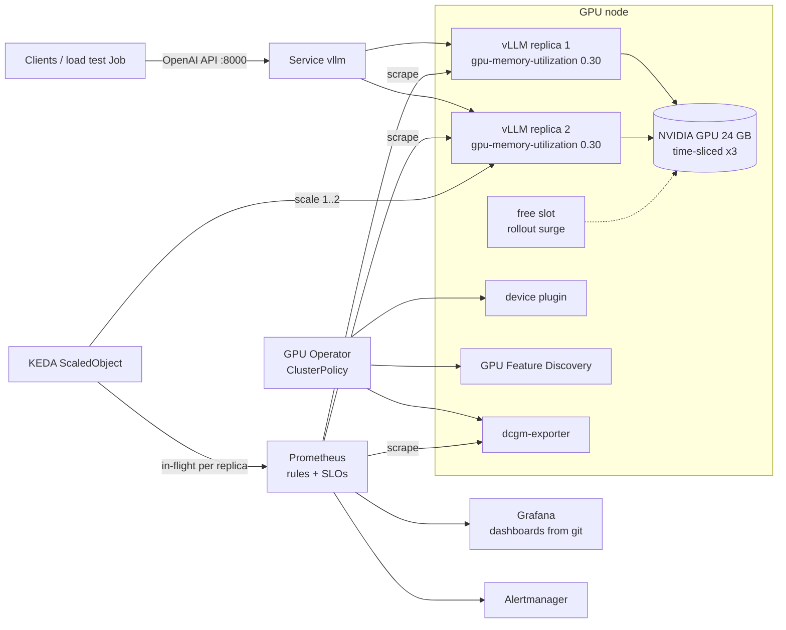

# GPU Inference Platform

[](https://github.com/anddr13/gpu-inference-platform/actions/workflows/ci.yaml)
[](LICENSE)

Production-style LLM serving on Kubernetes: **NVIDIA GPU Operator**, **vLLM**, **KEDA**,
**Prometheus + Grafana** with SLOs, burn-rate alerts and runbooks. Runs on one GPU machine (k3s) or on
AWS EKS with Spot or on-demand GPU nodes (Terraform). Everything is code, and the alert rules have promtool unit tests.

**TL;DR from the first real run** (EKS, one NVIDIA A10G, vLLM v0.32, Qwen2.5-1.5B, 2026-10-26):

- **3,936 generated tokens/s** on one GPU at 96 concurrent requests, 0 errors in 10,096 requests, every SLO met.
- **One replica per whole GPU beat two time-sliced replicas by 36-63%** in throughput, with 37-44% lower
  inter-token latency. EKS now runs that way; [benchmarks](docs/benchmarks.md), [raw output](docs/results/).
- **~$0.09 per 1M generated tokens** on on-demand g5.2xlarge, from a cluster that `make eks-up` builds and
  `make eks-down` removes, with a cost preflight and a leftovers check.

## What this project demonstrates

| Area | Where |
|---|---|
| GPU node operations: driver/toolkit modes, device plugin, GPU Feature Discovery, DCGM telemetry, GPU sharing | `platform/gpu-operator/`, [ADR 0001](docs/adr/0001-gpu-operator.md), [ADR 0003](docs/adr/0003-gpu-sharing.md) |
| LLM serving: vLLM tuned for memory budget, probes for multi-minute cold starts, graceful drain, PDB | `charts/vllm/`, [ADR 0002](docs/adr/0002-vllm-serving-engine.md) |
| Autoscaling on an LLM-specific signal (in-flight requests), calibrated by load testing | `charts/vllm/templates/scaledobject.yaml`, [ADR 0004](docs/adr/0004-autoscaling-signal.md) |
| Observability: DCGM + vLLM dashboards as code, recording rules, cost per 1M tokens | `observability/`, `charts/llm-observability/` |
| SRE: two SLOs, multi-window burn-rate alerts, runbook per alert, failure drills | [SLOs](docs/slo.md), [runbooks](docs/runbooks.md), [drills](docs/drills.md) |
| Infrastructure as code: EKS, GPU node group with taints, AL2023 NVIDIA AMI, remote state in S3 with native locking; cost guard rails: read-only preflight (quota, Spot price, placeholders), AWS Budget alert, leftovers check after destroy | `infra/aws-eks/` |
| Quality gates: helm lint, kubeconform (CRDs too), promtool unit tests, helmfile render against upstream charts, terraform validate, shellcheck | `.github/workflows/ci.yaml`, `make lint` |
| End-to-end test without a GPU: the whole platform on kind with a fake vLLM that exports vLLM's real metrics; CI proves scraping, rules, dashboards, KEDA scale-out and a burn-rate alert | `make dev-up e2e`, `tests/e2e/`, `loadtest/fake_vllm.py` |

## Architecture

The single-GPU k3s lab profile. On EKS each replica gets a whole GPU instead (`exclusive`), because the
benchmark measured what time-slicing costs.



| Component | Version | Role |
|---|---|---|
| NVIDIA GPU Operator | v26.7.2 | Device plugin, GFD, DCGM exporter, MIG manager, validator, time-slicing config |
| vLLM | v0.32.0 | OpenAI-compatible server, continuous batching, prefix caching |
| KEDA | 2.21.0 | Prometheus-driven HPA |
| kube-prometheus-stack | 92.11.0 | Prometheus, Alertmanager, Grafana, kube-state-metrics |
| Model | Qwen2.5-1.5B-Instruct (pinned revision) | Ungated; two replicas + a rollout surge slot fit one 24 GB GPU |
| k3s / EKS | 1.36 | Lab cluster / cloud cluster |

## Quick start

```bash
# 1. A cluster with an NVIDIA GPU (details: docs/setup.md)
sudo bash infra/k3s/bootstrap.sh        # on a GPU box, or: make eks-up

# 2. Platform + model
export GRAFANA_ADMIN_PASSWORD='pick-one'
make platform ENV=k3s                # or ENV=eks

# 3. Check every layer
make gpu-status gpu-test smoke
make grafana                         # http://localhost:3000 → folder "LLM Platform"
make loadtest                        # finds the highest concurrency that meets the TTFT SLO
```

### No GPU? Run everything else on a laptop

```bash
make dev-up        # kind + kube-prometheus-stack + KEDA + dashboards + alerts, fake vLLM instead of the GPU
make e2e           # scraping, rule groups, Grafana dashboards, KEDA scale-out, SLO burn-rate alert
make fault ERROR_RATE=0.3 TTFT=3   # drill: watch the burn-rate alerts fire in Grafana / Alertmanager
```

`loadtest/fake_vllm.py` speaks the OpenAI streaming API and exports vLLM's metric names, labels and
histogram buckets, with a latency model (batch slots, queueing, KV cache) and fault injection. The chart,
ServiceMonitor, KEDA trigger, rules and dashboards are the same ones that run on the GPU. Only the GPU
Operator is skipped. The dev cluster uses its own kubeconfig, so work contexts stay untouched.

## Observability

**LLM Serving - vLLM**: requests/s, TTFT and inter-token latency percentiles, where time goes (queue /
prefill / decode), tokens/s, finish reasons, HTTP status, running vs waiting, KV cache, preemptions, prefix
cache hit ratio, replicas, SLO compliance and burn rate, generated tokens/s per GPU, cost per 1M tokens.

**GPU Fleet - DCGM**: utilisation vs real SM / tensor occupancy, memory bandwidth, PCIe, framebuffer,
temperature, power, clocks and throttling, XID errors, row remapping, GPU Operator health, per-workload
attribution.

Both dashboards during the first EKS run (A10G, 2026-10-26, 09:40-10:10 UTC). Left half of every graph:
experiment 1, two time-sliced replicas with KEDA scaling 1 → 2. Right half: experiment 2, one exclusive
replica. Click to enlarge.

<p>
  <a href="docs/images/grafana-llm-serving.png"></a>
  <a href="docs/images/grafana-gpu-fleet.png"></a>
</p>

What the GPU dashboard shows: utilisation is pinned at 100% under any load, but SM active sits at ~80% and
the tensor pipe at only 12-27%, while DRAM is ~70% busy. Decoding a small model is memory-bandwidth bound.
Framebuffer jumps from ~60% to 92% when the single exclusive replica takes `gpu-memory-utilization 0.90`.

**Alerts** ([runbooks](docs/runbooks.md)): user symptoms page through SLO burn rates; causes such as KV cache
saturation, preemptions, queueing and autoscaler at max open tickets; GPU health covers critical XIDs, row
remap failure, a node that stopped advertising GPUs, missing telemetry, throttling and idle-but-allocated GPUs.

Dashboards are generated by `observability/build_dashboards.py`; CI fails if the committed JSON is stale.
Alert rules are plain Prometheus files with promtool unit tests in `observability/tests/`.

## Results

First run on 2026-10-26: EKS 1.36 in eu-north-1, one g5.2xlarge (NVIDIA A10G 24 GB, driver 580.178.04),
vLLM v0.32.0, Qwen2.5-1.5B-Instruct, 512 prompt / 256 output tokens, in-cluster load test.
Method and the full table: [docs/benchmarks.md](docs/benchmarks.md).

| Metric | Value |
|---|---|
| Errors | 0 of 4,421 requests, concurrency 1 → 96 |
| Highest tested concurrency meeting TTFT p95 <= 2.5 s | 96 (TTFT p95 1.42 s, inter-token latency p50 34 ms) |
| Peak throughput, lab profile (2 time-sliced replicas) | 2,687 generated tokens/s at concurrency 96 |
| Cost per 1M generated tokens at that peak | ~$0.13 (GPU node, $1.285/h on-demand); ~$0.17 for the whole cluster |
| Cold start, fresh node | 5 min 20 s to Ready: image pull 3 min 49 s (~10 GB), weights + compile + CUDA graphs ~76 s |
| Cold start, image cached (KEDA scale-out) | 1 min 51 s; KEDA asked for the 2nd replica 15 s after in-flight crossed the target |
| Scaling out on a time-sliced GPU | barely helps: one replica did 2,426 tok/s at concurrency 32; two replicas sharing the A10G did 2,177-2,294 at 48-64 and 2,687 (+11%) at 96, while inter-token latency p50 went from 12 ms to 34 ms |
| GPU utilisation | 100% from concurrency 8 to 96 while throughput tripled; SM active 0.73-0.83. Utilisation is not a load signal |
| 7B on L4: bf16 vs AWQ (3 runs each) | AWQ **1.5-2.9x faster**; bf16 misses the 50 ms/token SLO even at 1 request (memory-bandwidth bound), AWQ meets every SLO up to 32 concurrent at **~$0.30 per 1M tokens** |
| L4 vs A10G (1.5B, exclusive) | L4 19% slower (3,170 vs 3,936 tok/s) and 19% cheaper: same cost per token |
| 1 exclusive replica (0.90) vs 2 time-sliced (0.30) | exclusive wins: **+36-63% tokens/s** and 37-44% lower inter-token latency at concurrency 48-96; peak 3,936 tok/s, **~$0.09 per 1M tokens**; TTFT p95 2.01 s vs 1.42 s is the trade-off |

## Gotchas this repo handles

- **An unschedulable replica is worse than none.** KEDA scaled to 2 replicas on a single GPU node; the
  Pending pod then deadlocked the next rollout for ~10 minutes (the old pod had to stay up and held the only
  GPU). `maxReplicas` now equals the GPU node count until nodes are provisioned automatically.
- **GPU capacity runs out.** eu-north-1 had no g6.2xlarge, then no g5.2xlarge, for over an hour; on-demand
  launches are "prioritized", so the group retried the first type instead of falling back. Order the types
  by availability, and expect to retry later.
- **The account spend limit is enforced by SCP.** When the forecast crossed the limit, `eks:CreateNodegroup`
  failed with an explicit deny, which reads like a permissions bug, not a budget one.

- **`VLLM_PORT` collision.** A Service named `vllm` makes Kubernetes inject `VLLM_PORT=tcp://...`, which vLLM
  reads for its own purposes and refuses to start. The Deployment sets `enableServiceLinks: false`.
- **GPU utilisation lies.** `DCGM_FI_DEV_GPU_UTIL` is the share of time any kernel ran: ~100% with one request
  or fifty. Real occupancy is `DCGM_FI_PROF_SM_ACTIVE`; the autoscaling signal is in-flight requests.
- **GPU memory alerts are noise with vLLM.** It pre-allocates `--gpu-memory-utilization` of the card. KV cache
  usage is the meaningful metric.
- **`exported_pod`, not `pod`.** dcgm-exporter attributes GPUs to pods, and with `honorLabels: false`
  Prometheus renames those labels to `exported_*`. The exporter's own target labels stay intact.
- **Time-slicing has no memory isolation.** Replicas sharing a GPU must split memory themselves (0.30 each).
- **Rolling updates need a free GPU.** With `maxUnavailable: 0` the surge pod must schedule first; at max
  replicas on a full GPU it waits forever. The lab time-slices into 3 slots for 2 replicas (N+1).
- **`minAvailable: 1` with one replica blocks every node drain.** The PDB uses `maxUnavailable: 1`.
- **CUDA 13 image, driver >= 580.** Older drivers need the `-cu129` image tag.
- **Cold starts are minutes**: no scale-to-zero, long startup probe, slow scale-down, model cache volume.
- **Load testing through `kubectl port-forward` distorts latency.** The load test runs as an in-cluster Job.
- **The EKS module ignores `desired_size` after creation**, so GPU nodes are paused with `make gpu-nodes N=0`.
- **`aws login` credentials live 15 minutes; an EKS apply takes longer.** Exported once, they expire while
  Terraform waits for the control plane. Terraform runs through a `credential_process` profile that refreshes
  them, and the base profile needs a region or the refresh itself fails. Found on the first real apply:
  the cluster came up ACTIVE but tainted in state, fixed with `terraform untaint` instead of a rebuild.
- **Some series exist only after the first bad event.** `http_requests_total{status="5xx"}` appears with the
  first 5xx and `DCGM_FI_DEV_XID_ERRORS` with the first XID, so "never failed" rendered as "No data" (and a
  cost panel divided by zero showed $∞). Queries use `or vector(0)` / `or ... * 0`, with a promtool test.
- **`helm --wait` does not wait with `replicas: 1` and `maxUnavailable: 1`.** Zero ready pods already
  satisfies "replicas minus maxUnavailable", so the upgrade reports success while the new pod is still
  Pending. Follow with `kubectl rollout status`, or keep `maxUnavailable: 0` where a surge slot exists.
- **AWS Free plan accounts cannot run this lab.** An SCP denies Spot, and EC2 launches only free-tier
  instance types, which a `run-instances --dry-run` does not reveal: the node groups sat in CREATING
  while the Auto Scaling groups failed with "not eligible for Free Tier". The preflight now reads the
  plan from the Free Tier API and stops before `terraform apply`.

## Repository layout

```
charts/vllm/                  vLLM Helm chart: Deployment, Service, ServiceMonitor, PDB, KEDA, NetworkPolicy
charts/llm-observability/     dashboards (generated JSON) + Prometheus rules → ConfigMaps / PrometheusRules
platform/                     values for GPU Operator and kube-prometheus-stack, CUDA smoke test
serving/vllm/                 lab profile + per-environment overlays (k3s, eks, dev)
helmfile.yaml.gotmpl          all releases, ordered, pinned; environments k3s / eks / dev
observability/                dashboard generator, promtool unit tests
loadtest/                     staged load generator, fake vLLM, in-cluster Job
tests/e2e/                    end-to-end check on the kind dev cluster
infra/k3s/                    single GPU host bootstrap (driver, toolkit, k3s)
infra/aws-eks/                Terraform: VPC, EKS, system + Spot GPU node groups
infra/kind/                   no-GPU dev cluster
docs/                         setup and costs, ADRs, SLOs, runbooks, drills, benchmarks
```

## Roadmap

1. **Triton Inference Server + TensorRT-LLM** next to vLLM on the same GPU: same load test, same dashboards,
   documented trade-off between raw speed and the engine build pipeline.
2. **Karpenter** GPU NodePools: Spot with on-demand fallback, scale GPU nodes from zero, consolidation.
3. **Gateway API Inference Extension**: route by queue depth and KV cache state instead of round-robin.
4. **Argo CD** app-of-apps instead of `helmfile apply`.
5. **Faster cold starts**: model weights on S3 streamed at load time, pre-pulled images.
6. **MIG** profiles on an A100/H100 node, compared with time-slicing.
7. Blackbox probe from outside the cluster, OpenTelemetry traces through a gateway.

## Local checks

```bash
make lint          # helm lint + kubeconform, promtool tests, ruff, stale-dashboard check
make dashboards    # regenerate Grafana JSON after editing observability/build_dashboards.py
make dev-up e2e    # full platform on kind, end-to-end assertions (what CI's e2e job runs)
```

Every cluster-facing `make` target talks to the lab cluster of `ENV` through that cluster's own kubeconfig file
(`~/.kube/gpu-lab.yaml`, `~/.kube/eks-gpu-inference.yaml`, `~/.kube/kind-gpu-lab-dev.yaml`) and refuses to run if it
does not exist, so `~/.kube/config` and its work contexts are never used. `make platform` additionally shows the
context and asks before deploying (`YES=1` skips the prompt).
