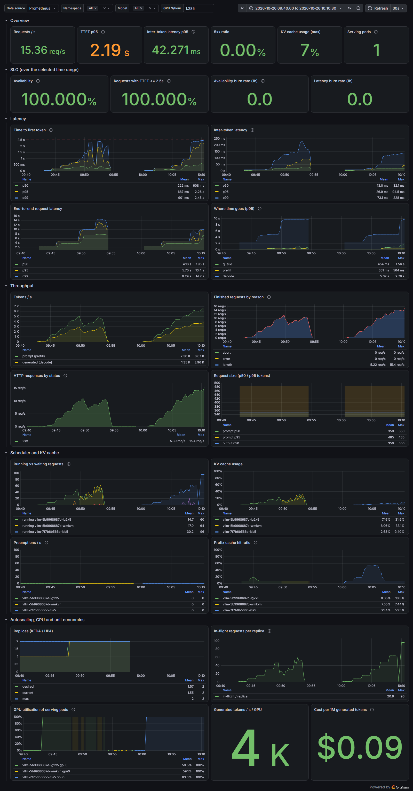
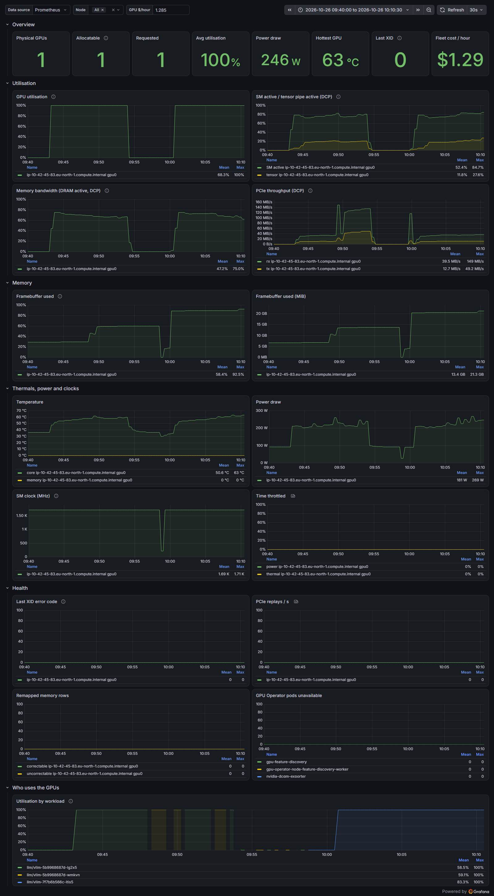

# Benchmarks

Numbers only count if someone can reproduce them. Every run records the hardware, versions and exact
command. Raw output of each run is committed in [results/](results/).

## Method

- In-cluster Job (`make loadtest`), not through `kubectl port-forward`, which serialises streams through the
  API server and adds latency at high concurrency.
- Closed loop: each virtual user sends the next request when the previous one finishes, so concurrency is
  the controlled variable.
- `ignore_eos` on: every request generates exactly `max_tokens`, so runs are comparable.
- First stage at concurrency 1 doubles as the baseline (no batching effects).
- Pass/fail per stage: TTFT p95 <= 2.5 s and < 1% errors (the latency SLO).

## Environment (run of 2026-10-26)

| | |
|---|---|
| Cluster | EKS 1.36.5, eu-north-1, AMI `AL2023_x86_64_NVIDIA` v20261019 |
| GPU / instance | 1x NVIDIA A10G 24 GB, g5.2xlarge on-demand ($1.285/h) |
| Driver | 580.178.04 (from the AMI), GPU Operator v26.7.2, time-slicing x3 |
| vLLM | v0.32.0, `gpu-memory-utilization 0.30`, `max-num-seqs 64`, `max-model-len 8192` |
| Model | Qwen/Qwen2.5-1.5B-Instruct, bf16, revision `989aa79` |
| KV cache per replica | 109,968 tokens (vLLM log) |
| Load | 512 prompt / 256 output tokens, stages 1, 8, 16, 32, 48, 64, 96 x 90 s |

## Experiment 1: concurrency sweep with KEDA on

Lab profile as deployed on that day: KEDA scales 1-2 replicas at 24 in-flight requests per replica, both replicas
time-share the one A10G.

| Concurrency | Replicas | req/s | out tok/s | TTFT p50 | TTFT p95 | ITL p50 ms | ITL p95 ms | E2E p95 | SLO |
|---|---|---|---|---|---|---|---|---|---|
| 1 | 1 | 0.47 | 119 | 0.04 | 0.05 | 8.3 | 8.4 | 2.15 | ok |
| 8 | 1 | 3.33 | 852 | 0.15 | 0.20 | 8.9 | 9.3 | 2.42 | ok |
| 16 | 1 | 5.93 | 1,519 | 0.23 | 0.34 | 9.7 | 10.4 | 2.73 | ok |
| 32 | 1 → 2 | 9.47 | 2,426 | 0.38 | 0.61 | 11.9 | 12.9 | 3.48 | ok |
| 48 | 2 (2nd Ready mid-stage) | 8.96 | 2,294 | 0.34 | 0.96 | 15.5 | 27.7 | 7.31 | ok |
| 64 | 2 | 8.50 | 2,177 | 0.26 | 0.99 | 28.1 | 30.6 | 8.11 | ok |
| 96 | 2 | 10.50 | 2,687 | 0.31 | 1.42 | 34.1 | 38.3 | 10.26 | ok |

0 errors in 4,421 requests.

What it shows:

- **TTFT never got close to the SLO.** A 1.5B model on an A10G is prefill-cheap; the binding constraint
  is decode speed (inter-token latency), not time to first token. For this model the SLO should add an
  ITL target, e.g. p95 <= 50 ms.
- **The second time-sliced replica barely helped.** One replica did 2,426 tok/s at concurrency 32; two
  replicas on the same GPU did 2,177-2,294 tok/s at 48-64 and 2,687 tok/s (+11%) at 96, while inter-token
  latency p50 rose from 12 ms to 34 ms. Two processes take turns on the SMs instead of batching together.
  One replica was not measured above 32 here, so experiment 2 has to separate the time-slicing cost from
  plain batch growth. Working conclusion (ADR 0003): on a time-sliced GPU, scaling out adds batch slots and
  pod-level isolation, not compute.
- **GPU utilisation read 100% from concurrency 8 to 96** while throughput tripled. `DCGM_FI_PROF_SM_ACTIVE`
  stayed at 0.73-0.83. Utilisation says "busy", never "full".
- **KEDA reacted in 15 s** (desired 2 at 09:47:39, stage started 09:47:24) and the new replica was Ready
  1 min 51 s later. Most of the gap was model download and torch.compile into a fresh emptyDir.

## Experiment 2: one exclusive replica vs two time-sliced replicas

Same node, same sweep, switched live: `nvidia.com/device-plugin.config=exclusive` (allocatable 3 → 1 in
~10 s), one replica, `gpuMemoryUtilization 0.90`, `max-num-seqs 128` (the same batch slots as 2 x 64),
autoscaling off. KV cache: 606,160 tokens instead of 109,968 per time-sliced replica. Ready 1 min 30 s
after the rollout started.

| Concurrency | out tok/s, 1 exclusive | out tok/s, exp. 1 | Δ | ITL p50 ms, exclusive / exp. 1 | TTFT p95 s, exclusive / exp. 1 |
|---|---|---|---|---|---|
| 1 | 119 | 119 | 0% | 8.4 / 8.3 | 0.05 / 0.05 |
| 8 | 858 | 852 | +1% | 8.9 / 8.9 | 0.17 / 0.20 |
| 16 | 1,600 | 1,519 | +5% | 9.6 / 9.7 | 0.22 / 0.34 |
| 32 | 2,584 | 2,426 | +7% | 11.8 / 11.9 | 0.37 / 0.61 |
| 48 | 3,110 | 2,294 | **+36%** | 13.8 / 15.5 | 0.91 / 0.96 |
| 64 | 3,550 | 2,177 | **+63%** | 15.8 / 28.1 | 1.27 / 0.99 |
| 96 | 3,936 | 2,687 | **+46%** | 21.5 / 34.1 | 2.01 / 1.42 |

0 errors in 5,675 requests. Up to 32 the runs match (one replica either way); from 48 on, where experiment 1
ran two time-sliced replicas, one exclusive replica wins clearly:

- **+36-63% tokens/s and 37-44% lower inter-token latency** at 48-96 concurrent. One process batches all
  sequences on the GPU at once; two time-sliced processes take turns and each runs a half-size batch.
- **TTFT p95 is the price**: 2.01 s at 96 against 1.42 s, because a single scheduler interleaves all the
  prefills with decode. Still inside the 2.5 s SLO.
- **Conclusion for production**: scale out with whole GPUs (one replica per GPU, or MIG on H100-class), not
  with time-slicing. The lab keeps time-slicing only for the N+1 rollout slot on a single-GPU node, and
  that slot costs real throughput.
- At $1.285/h the GPU now produces 14.2M tokens/hour: **~$0.09 per 1M generated tokens** (GPU node),
  ~$0.11 for the whole cluster, against $0.13 / $0.17 in experiment 1.

### Dashboards during experiments 1 and 2

Left half of each graph: experiment 1. Right half: experiment 2.

## Experiment 3: prefix caching

`--shared-prefix-tokens 0` vs `2000` at concurrency 16. Compare TTFT p95 and the prefix cache hit ratio.

## Experiment 4: cold start breakdown

| Phase | emptyDir, fresh node | emptyDir, image cached | PVC cache |
|---|---|---|---|
| Image pull | 3 min 49 s (~10 GB) | 0 | n/a on EKS |
| Weights download + load | 23 s | (included below) | |
| torch.compile + CUDA graphs + KV cache init | 26 s (compile 16 s) | | |
| Pod start → Ready | 5 min 20 s | 1 min 51 s | |

Read the phases from `kubectl describe pod` events and the vLLM log timestamps.

## Unit economics

At the peak of each run (concurrency 96):

| Setup | Generated tokens/hour | $ per 1M, GPU node only ($1.285/h) | $ per 1M, whole cluster (~$1.60/h) |
|---|---|---|---|
| Experiment 1: 2 time-sliced replicas | 9.7M | ~0.13 | ~0.17 |
| Experiment 2: 1 exclusive replica | 14.2M | ~0.09 | ~0.11 |
